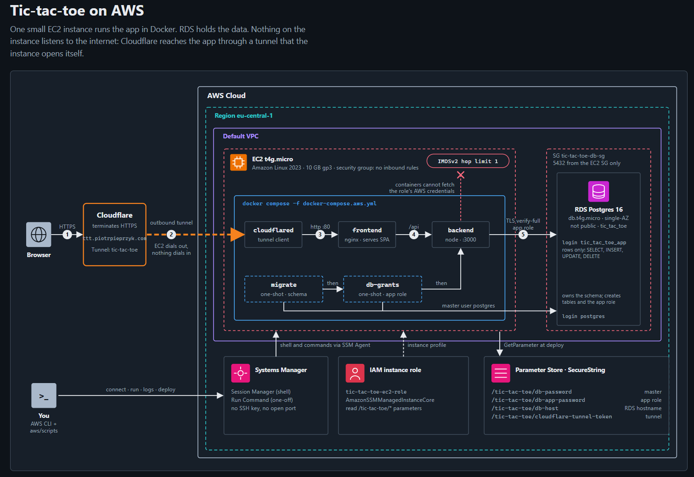

# Tic-tac-toe with server

A multiplayer tic-tac-toe game: players pick a name, create or join a room, and play in real time over websockets.
I built it to learn. Backend development, AWS and Terraform were new to me, and the project is where I practised them
end to end, from a domain model to a deployed, HTTPS-secured stack.

## Content

- [Architecture](#architecture)
- [Technology stack](#technology-stack)
- [Running the project](#running-the-project)
    - [Locally in Docker](#locally-in-docker)
    - [Tests against a real database](#tests-against-a-real-database)
    - [Playing with friends on the same network](#playing-with-friends-on-the-same-network)
    - [On AWS](#on-aws)
- [Code design principles](#code-design-principles)
- [History](#history)
- [Game rules](#game-rules)

---

## Architecture



One small EC2 instance runs the app in Docker and RDS holds the data. Nothing on the instance listens to the internet:
Cloudflare reaches the app through a tunnel that the instance opens itself. Locally, the same containers run through
`docker-compose.yml` with a Postgres container in place of RDS.

---

## Technology stack

| Sub-project                | Stack                                                                                                                                                                                           |
|----------------------------|-------------------------------------------------------------------------------------------------------------------------------------------------------------------------------------------------|
| **Frontend** (`frontend/`) | React 19, TypeScript, Vite, React Router, Tailwind CSS v4, React Compiler, Storybook 10, Vitest (jsdom + Playwright browser mode), Testing Library, ESLint (layer import rules), nginx for the production build |
| **Backend** (`backend/`)   | Node.js 22, TypeScript, Express, `ws` (websockets), PostgreSQL 16 via `pg`, `node-pg-migrate`, Jest + ts-jest + Supertest, OpenAPI specs in `documentations/openapi/`                          |
| **AWS** (`aws/`)           | Terraform (S3 remote state), EC2 `t4g.micro` (Amazon Linux 2023, Docker Compose), RDS Postgres 16, IAM, Systems Manager (Session Manager, Run Command, Parameter Store), Cloudflare Tunnel + DNS, Node.js ops scripts |
| **Local tooling**          | Docker Compose: Postgres, backend (hot reload), frontend (Vite dev server), test runner, production frontend preview                                                                           |

---

## Running the project

### Locally in Docker

Requirements: Docker Desktop.

```sh
cp .env.example .env          # optional: only needed to override defaults
docker compose up --build
```

| Service  | URL                     | Notes                                               |
|----------|-------------------------|-----------------------------------------------------|
| Frontend | <http://127.0.0.1:4000> | Vite dev server, hot reload                         |
| Backend  | <http://127.0.0.1:3000> | nodemon + ts-node; runs migrations on start         |
| Postgres | `localhost:5432`        | `postgres` / `postgres`, database `tic_tac_toe`     |

To test the production bundle (built with `vite build`, served by nginx) instead of the dev server:

```sh
docker compose --profile prod up --build frontend-prod   # http://127.0.0.1:8080
```

Database commands (migrations, rollbacks, inspecting constraints) are in
[`backend/src/infrastructure/databases/postgres/README.md`](backend/src/infrastructure/databases/postgres/README.md).

**How to play:** enter your name, create or join a room, and the host starts the game once a second player has joined.

### Tests against a real database

The backend's story tests run against the Mock repositories by default. With `DATABASE_URL` set, they run against a
real Postgres instead. The `backend-test` service does that against a separate `tic_tac_toe_test` database, so dev data
is never touched. The test database is created on first initialisation of the Postgres volume
(`postgres/init/01-create-test-db.sh`).

```sh
docker compose --profile test run --rm backend-test
```

It applies the migrations, then runs Jest with `--runInBand`. Each test file starts by truncating every table, so
parallel workers would race.

Other test commands:

```sh
cd backend  && npm test               # backend against Mock repositories, no database needed
cd frontend && pnpm test              # frontend: unit (jsdom), story specs and Storybook (Playwright Chromium)
```

### Playing with friends on the same network

Your friends' browsers must reach both the frontend (port `4000`) and the backend (port `3000`) on your machine, and
the frontend must call the backend at your LAN IP instead of `127.0.0.1`. With the stack running, run this in
PowerShell **as Administrator** from the repo root (if you're on cable, replace `"Wi-Fi"` with your adapter name from
`Get-NetAdapter`):

```powershell
# Read your Wi-Fi adapter's LAN IP (the address everyone will use)
$ip = (Get-NetIPAddress -InterfaceAlias "Wi-Fi" -AddressFamily IPv4).IPAddress
# Mark the Wi-Fi network as Private, so the Private-only firewall rule below applies to it
Set-NetConnectionProfile -InterfaceAlias "Wi-Fi" -NetworkCategory Private
# Allow inbound connections to the backend (3000) and the frontend (4000) on Private networks
New-NetFirewallRule -DisplayName "Tic-Tac-Toe Dev (3000,4000)" -Direction Inbound -Protocol TCP -LocalPort 3000,4000 -Action Allow -Profile Private
# Point the frontend at the backend on your LAN IP (overrides VITE_API_DOMAIN from .env in this shell only)
$env:VITE_API_DOMAIN = "http://${ip}:3000"
# Recreate the frontend container so it picks up the new backend address
docker compose up -d --force-recreate frontend
# Print the address to share with your friends
"Open http://${ip}:4000"
```

All players open the printed address, **including you**: the session cookie is tied to the host name, so mixing
`127.0.0.1` and the LAN IP breaks it. The backend's CORS list (`backend/src/app.ts`) already accepts port `4000` on
private ranges (`192.168.*`, `10.*`, `172.16–31.*`). Your IP comes from the router and may change after reconnecting;
if it does, run the script again (skip the firewall line, the rule already exists).

**Rollback** (PowerShell as Administrator, from the repo root):

```powershell
# Delete the firewall rule
Remove-NetFirewallRule -DisplayName "Tic-Tac-Toe Dev (3000,4000)"
# Set the Wi-Fi network back to Public (skip this if it was Private before)
Set-NetConnectionProfile -InterfaceAlias "Wi-Fi" -NetworkCategory Public
# Drop the LAN IP override, so the frontend uses the .env / default backend address again
Remove-Item Env:VITE_API_DOMAIN -ErrorAction SilentlyContinue
# Recreate the frontend container with the localhost backend address
docker compose up -d --force-recreate frontend
```

### On AWS

The AWS deployment uses Terraform for infrastructure and small Node scripts for deploys, logs and shell access. It
costs about $0.035/hour while running and can be paused or fully torn down. Setup, commands and teardown are in
**[aws/README.md](aws/README.md)**. If you are new to Terraform, there is a [learning guide](aws/learning/README.md).

---

## Code design principles

I used the project to practise four ideas together: **TDD**, **DDD**, **Clean Architecture** and **enterprise
application patterns**. The rules are written down for both humans and Claude Code in
[`backend/CLAUDE.md`](backend/CLAUDE.md), [`frontend/CLAUDE.md`](frontend/CLAUDE.md) and the skills under
[`frontend/.claude/skills/`](frontend/.claude/skills).

### TDD: stories first, then tests, then code

- Every feature starts as a **user story** in Markdown (`backend/documentations/stories/**`,
  `frontend/doc/stories/**`). The story fixes the behaviour, one `#### WHEN …` per scenario, and on the frontend also
  the exact `data-testid` tree.
- Next to each story is a test file written **before** the implementation. A failing test on a missing element is the
  expected starting point, and assertions are never bent to make them pass: the test is the spec.
- Tests are black-box and behaviour-focused: they check visible text, colours, enabled/disabled state, focus,
  navigation and API calls. They avoid snapshots, CSS-class queries and internal state. Assertions that share the same
  `WHEN` go in one test.
- Shared mocks, builders and `getX` element helpers live in a per-feature `shared/` folder.

### DDD: a rich, pure domain

- Aggregates are `User`, `Room` and `Game` (with `Player` and `Cell`). Domain-named methods such as
  `room.hostRenames(...)` and `game.playerMarksCell(...)` carry the business rules.
- **Entities are pure:** they hold no repository references and have no async side effects. Mutating methods return a
  new instance, or `undefined` when the aggregate should be deleted.
- **Value objects** (`UserId`, `RoomName`, `Position`, `Mark`, `GameStatus`, …) are used at method boundaries instead of
  primitives.
- Domain code throws **domain errors** (`ValidationError`, `ForbiddenError`, `NotFoundError`, `InvalidStateError`).
  Only the HTTP error middleware turns them into status codes.

### Clean Architecture: dependencies point inward

- **Backend:** `domain/` <- `application/` <- `infrastructure/`. The domain imports nothing from the outer layers. Routers
  are thin (parse → domain → repository → DTO → respond) and double as the use-case layer, which is an accepted
  simplification at this size.
- **Frontend:** (domain layer in progress!) <- `app/` <- `infra/`. These rules are **enforced by
  ESLint** (`no-restricted-imports`). Relative imports are not allowed; code imports through the `@/` and `@doc/`
  aliases.
- The concrete implementations are wired in at a single **composition root**: `getApp(repositories)` on the backend,
  `App.tsx` on the frontend. Any of them can be swapped, e.g. Mock repositories for Postgres, or mocks in tests.
- On the frontend, components are split by concern, not size: one folder and one root component per feature, and hooks
  for reusable logic. Siblings talk through small scoped event buses instead of prop-drilling.

### Enterprise application patterns

- **Repository:** the interface is in the domain and returns domain entities. The Mock (in-memory) and Postgres
  implementations live in infrastructure.
- **Data Mapper:** `*Map.ts` converts entity → API DTO, and `*PersistenceMap.ts` converts entity ↔ database row, so
  persistence shapes never leak into the domain.
- **Dependency injection:** routers receive repositories through constructors, typed by interface.
- **Value Object**, **Identity Field** (GUID-based IDs) and **Separated Interface** (child-entity repositories kept
  internal to infrastructure).
- **Contract first:** the REST and websocket API is described in OpenAPI (`backend/documentations/openapi/`).

---

## History

Highlights from the git history:

| When                    | Milestone                                                                                                                                                                                  |
|-------------------------|--------------------------------------------------------------------------------------------------------------------------------------------------------------------------------------------|
| **Nov 2024 – Apr 2025** | First prototype: an Express server with user endpoints, a rooms page and room management, built without a clear structure.                                                                |
| **Jun – Jul 2026**      | **Backend rewrite, story-driven.** User stories and tests for Menu, Room and Game came first, then the implementation. The app was refactored to Clean Architecture and DDD, OpenAPI specs were updated, and the backend for the full game was finished. |
| **Sep 2026 (early)**    | **Frontend rebuilt from scratch.** Old files were removed, frontend stories and tests were written first, then Vite + React with path aliases, ESLint layer rules, Tailwind and a Storybook component library (Button, TextField, TerminalCard, …). |
| **Sep 2026 (mid)**      | Menu, Room and Game pages shipped in small versioned steps (`Room list v1.0 … v1.5`, `Room page v0.1 … v1.5`, `Game page v0.1 … v1.3`). This added real-time updates over websockets, playing over local Wi-Fi, and a Claude Code skill for structuring app components. |
| **Sep 23–24, 2026**     | **PostgreSQL:** Docker Compose setup, migrations, and Postgres repositories next to the Mock ones. The whole story test suite passes against a real database.                            |
| **Sep 24 – Oct 9, 2026**| **AWS v1:** EC2 + RDS deployed with Node scripts, a security-hardening pass after review, a least-privilege database app role, an AWS learning roadmap, and HTTPS via a Cloudflare Tunnel. |
| **Oct 14–16, 2026**     | **Infrastructure as Code:** the scripts were replaced with Terraform, including the Cloudflare Tunnel and DNS, with an S3 remote-state bootstrap and slim `ops/` scripts. READMEs were cleaned up. |

---

## Game rules

1. The game is played on a 3×3 grid.
2. The first player is X, the second player is O.
3. The players take turns.
4. The first player to place three marks in a horizontal, vertical or diagonal row wins.
5. If the grid is full and nobody has won, the game is a draw.
