# Terraform learning guide for this project

This guide takes you from "Terraform is new to me" to understanding every line in [`aws/v2-terraform/`](..). It
assumes you know the AWS side from the [v1 learning roadmap](../../v1-node-scripts/learning/README.md). The AWS
services are the same; what's new is the *way* they are created.

Like the v1 roadmap, each stage has:

- **Why**: where the topic shows up in this project.
- **Learn**: the concepts, with links to the official docs.
- **Read in the repo**: the files to read once the concepts make sense.
- **Do**: something to run.
- **Check yourself**: questions to answer before moving on.

Stages 0–3 and the two labs in [`examples/`](examples) need no AWS account and cost nothing. The last section is a
checklist of **IaC best practices**, each linked to where this stack follows it (or why it doesn't).

```mermaid
flowchart LR
    S0[0. Mental model] --> S1[1. HCL language]
    S1 --> S2[2. Providers and versions]
    S2 --> S3[3. Workflow: plan / apply]
    S3 --> S4[4. State]
    S4 --> S5[5. Dependency graph]
    S5 --> S6[6. v1 → v2 mapping]
    S6 --> S7[7. Lifecycle rules]
    S7 --> S8[8. Secrets]
    S8 --> S9[9. Pause / resume]
    S9 --> S10[10. Second provider:<br/>Cloudflare]
    S10 --> S11[11. Drift, import,<br/>refactoring]
    S11 --> S12[12. Best practices]
    S12 --> S13[13. Next steps]
```



**Useful everywhere:**

| Resource | What for |
|---|---|
| [Terraform docs](https://developer.hashicorp.com/terraform/docs) | Language and CLI reference |
| [AWS provider docs](https://registry.terraform.io/providers/hashicorp/aws/latest/docs) | Every `aws_*` resource and data source, with examples and the full argument list |
| [Cloudflare provider docs](https://registry.terraform.io/providers/cloudflare/cloudflare/latest/docs) | Every `cloudflare_*` resource |
| [HashiCorp tutorials: Get started on AWS](https://developer.hashicorp.com/terraform/tutorials/aws-get-started) | The official step-by-step intro |
| `terraform console` | An interactive prompt to try expressions (`formatdate(...)`, `split(...)`, ...) |
| `terraform <command> -help` | Help for each command |

---

## Stage 0: The mental model: imperative vs. declarative

**Why:** v1 and v2 create the same resources, but they think about it in opposite ways.

v1 is **imperative**: [`setup.mjs`](../../v1-node-scripts/scripts/setup.mjs) is a list of *steps*. Because steps
can run twice or crash halfway, every step needs its own "does it exist already?" check (`getSecurityGroupId(...) ??
createSg(...)`, `tryAws(..., /NoSuchEntity/)`). It also needs its own waiters, retries, and a separate
[`teardown.mjs`](../../v1-node-scripts/scripts/teardown.mjs) that deletes things in the right order.

v2 is **declarative**: the `.tf` files describe the *end result* ("there is a security group named
`tic-tac-toe-db-sg` that allows 5432 from the app group"). Terraform then:

1. **reads** what exists (using its **state**, stage 4, and the AWS APIs),
2. **compares** that with the code, and makes a **plan**: what to create, change or delete,
3. **applies** the plan in the right order, with waiting and retries built in.

Run it twice and the second run does nothing, because reality already matches the code. This "converge to the
desired state" idea is the core of Infrastructure as Code (IaC). Deleting is just another plan
(`terraform destroy`), worked out from the same code.

**Learn:**

- [What is Terraform](https://developer.hashicorp.com/terraform/intro)
- [Install Terraform](https://developer.hashicorp.com/terraform/install). On Windows: `winget install Hashicorp.Terraform`.
- Optional, the bigger picture: [what IaC is (AWS)](https://aws.amazon.com/what-is/iac/), and how Terraform compares
  with [CloudFormation](https://docs.aws.amazon.com/AWSCloudFormation/latest/UserGuide/Welcome.html) and the
  [AWS CDK](https://docs.aws.amazon.com/cdk/v2/guide/home.html). Terraform's advantage here: one tool for AWS **and**
  Cloudflare.

**Do:** install Terraform and run `terraform version`. Then read `setup.mjs` and [`infra/network.tf`](../infra/network.tf)
side by side.

**Check yourself:**
- `setup.mjs` re-applies security group rules on every run "so a run that crashed in between is repaired". Why doesn't
  `network.tf` need anything like that?
- Where is the v2 equivalent of `teardown.mjs`?

---

## Stage 1: The language (HCL)

**Why:** every `.tf` file is written in HCL, the HashiCorp Configuration Language. Terraform reads **all** `.tf` files
in a directory as one configuration (a *module*). The file names (`network.tf`, `iam.tf`, ...) are only for humans.

**Learn:** the building blocks, all of them used in [`infra/`](../infra):

| Block | Meaning | Example in this repo |
|---|---|---|
| `resource "TYPE" "NAME"` | Something Terraform **creates and owns** | `resource "aws_security_group" "app"` in [`network.tf`](../infra/network.tf) |
| `data "TYPE" "NAME"` | Something Terraform only **reads** | `data "aws_vpc" "default"`: the default VPC is never modified |
| `variable` | An **input** | `variable "enabled"` in [`variables.tf`](../infra/variables.tf) |
| `locals` | **Named values** computed inside the config | `local.names` in [`locals.tf`](../infra/locals.tf) |
| `output` | Values **printed** after apply | [`outputs.tf`](../infra/outputs.tf) |
| `ephemeral` | A value used **only during this run**, never saved | `ephemeral "random_password"` in [`secrets.tf`](../infra/secrets.tf) |
| `terraform { }` | Settings: versions, backend | [`versions.tf`](../infra/versions.tf), [`backend.tf`](../infra/backend.tf) |
| `provider` | Configures a plugin (region, credentials) | [`providers.tf`](../infra/providers.tf) |

**References** connect everything: `aws_security_group.app.id`, `data.aws_vpc.default.id`, `var.enabled`,
`local.names.db_sg`. A reference is also how Terraform learns the order (stage 5).

**Expressions** you'll see:

- **String templates**: `"${var.project}-app"`.
- **Conditionals**: `var.enabled ? "running" : "stopped"`.
- **`count`**: how many copies of a resource to make. `count = var.enabled ? 1 : 0` makes the resource *optional*.
  With `count`, the resource becomes a list: `aws_db_instance.db[0]`.
- **`for` expressions**: `[for r in list : r.x if condition]` (the snapshot lookup in
  [`database.tf`](../infra/database.tf)).
- **Built-in functions**: `file()`, `replace()`, `sort()`, `split()`, `formatdate()`, `startswith()`, and
  [many more](https://developer.hashicorp.com/terraform/language/functions).
- **Variable validation**: `validation { condition = ..., error_message = ... }` rejects bad input before anything
  runs (see `cloudflare_account_id` in [`variables.tf`](../infra/variables.tf)).

Docs:
[resources](https://developer.hashicorp.com/terraform/language/resources),
[data sources](https://developer.hashicorp.com/terraform/language/data-sources),
[variables](https://developer.hashicorp.com/terraform/language/values/variables),
[locals](https://developer.hashicorp.com/terraform/language/values/locals),
[outputs](https://developer.hashicorp.com/terraform/language/values/outputs),
[expressions](https://developer.hashicorp.com/terraform/language/expressions),
[`count`](https://developer.hashicorp.com/terraform/language/meta-arguments/count),
[`for_each`](https://developer.hashicorp.com/terraform/language/meta-arguments/for_each),
[style guide](https://developer.hashicorp.com/terraform/language/style).

**Variable values** come from, in increasing priority: `default` → `terraform.tfvars` → `*.auto.tfvars` →
`-var-file` → `-var` on the command line. Environment variables `TF_VAR_<name>` are read too
([precedence](https://developer.hashicorp.com/terraform/language/values/variables#variable-definition-precedence)).

**Read in the repo:** [`variables.tf`](../infra/variables.tf), [`terraform.tfvars`](../infra/terraform.tfvars),
[`locals.tf`](../infra/locals.tf) (compare it with v1's [`config.mjs`](../../v1-node-scripts/config.mjs)), then
[`network.tf`](../infra/network.tf) and [`iam.tf`](../infra/iam.tf).

**Do:** [Lab 01](examples/01-first-steps/main.tf). It runs offline, costs nothing, and teaches resources, variables,
locals, outputs and `count`. Follow the commands in its header comment.

**Check yourself:**
- What's the difference between `resource "aws_vpc"` and `data "aws_vpc"`? What would `terraform destroy` do to each?
- `iam.tf` builds policies with `data "aws_iam_policy_document"` instead of a JSON string. What do you gain?
  (Hint: typos and validation.)
- `count` vs. `for_each`: when would you choose `for_each`? (Hint: what happens to `[1]` and `[2]` when you remove
  item `[0]` of a list?)

---

## Stage 2: Providers, versions and the lock file

**Why:** Terraform itself knows nothing about AWS. **Providers** are plugins that translate resources into API
calls: `hashicorp/aws`, `cloudflare/cloudflare`, `hashicorp/random`, `hashicorp/time`.

**Learn:**

- [Provider requirements](https://developer.hashicorp.com/terraform/language/providers/requirements): `source` and
  `version` in `required_providers`.
- **Version constraints**: `~> 6.68` means "6.68 or newer, but below 7.0". Major versions may contain breaking
  changes, so you upgrade to them deliberately.
  [Version constraints](https://developer.hashicorp.com/terraform/language/expressions/version-constraints).
- The **dependency lock file** `.terraform.lock.hcl` records the *exact* versions and checksums `init` picked. It's
  committed, so everyone (and CI) gets the same plugins. Upgrade on purpose with `terraform init -upgrade`.
  The repo's lock files list checksums for Windows, Linux and macOS (`terraform providers lock -platform=...`), so they
  work on every machine. [Lock file](https://developer.hashicorp.com/terraform/language/files/dependency-lock).
- **Provider configuration**: `region`, and `default_tags`, which adds `Project=tic-tac-toe` and `ManagedBy=terraform` to
  every AWS resource. [default_tags](https://registry.terraform.io/providers/hashicorp/aws/latest/docs#default_tags-configuration-block).
- **Credentials never go in code.** The AWS provider uses the same credential chain as the AWS CLI (`aws login`),
  and the Cloudflare provider reads `CLOUDFLARE_API_TOKEN`.

**Read in the repo:** [`versions.tf`](../infra/versions.tf), [`providers.tf`](../infra/providers.tf),
[`.terraform.lock.hcl`](../infra/.terraform.lock.hcl).

**Check yourself:**
- Why does the project commit `.terraform.lock.hcl`, but git-ignore `.terraform/`?
- v1 adds `--tags` / `--tag-specifications` to every create call. Where does v2 do the same?

---

## Stage 3: The core workflow

**Why:** you'll run these commands every day.

```
terraform init        # download providers, connect to the backend (once, and after changing either)
terraform fmt         # format the code (the official style)
terraform validate    # catch syntax and type errors, offline
terraform plan -out tfplan   # compute the changes and SAVE them
terraform apply tfplan       # apply exactly the saved plan
terraform output      # show outputs again
terraform destroy     # plan and apply the deletion of everything in the state
```

**How to read a plan.** This is the most important Terraform skill:

| Symbol | Meaning | Danger |
|---|---|---|
| `+ create` | New resource | Low |
| `~ update in-place` | Changed without recreating | Usually low |
| `-/+ replace` (`must be replaced`) | **Deleted and created again.** The plan names the attribute that *"forces replacement"* | **High** for anything stateful: a replaced RDS instance or EC2 disk loses its data |
| `- destroy` | Deleted | High |
| `<= read` | A data source read during apply | None |

Always look at the summary line (`Plan: 2 to add, 1 to change, 0 to destroy`) and search for `replace` and
`destroy` before you type `yes`.

**Why `plan -out`?** Between `plan` and `apply`, someone (or something) could change the infrastructure. `apply tfplan`
does *exactly* what you reviewed, or fails if the state moved on. `.tfplan` files can contain secrets, so they are
git-ignored.

**Learn:** [core workflow](https://developer.hashicorp.com/terraform/intro/core-workflow),
[`plan`](https://developer.hashicorp.com/terraform/cli/commands/plan),
[`apply`](https://developer.hashicorp.com/terraform/cli/commands/apply).

**Do:** [Lab 02](examples/02-lifecycle/main.tf), steps 1 and 2: watch `destroy` and `-/+ replace` in a plan, offline.

**Check yourself:**
- In lab 01, `-var greeting=Hi` replaces two resources. Which line in the plan says *why*?
- What does Terraform do if you run `apply tfplan` twice?

---

## Stage 4: State

**Why:** Terraform must remember *which* real objects belong to *which* resource block: for example, that
`aws_instance.app` is `i-0abc...`. It keeps that mapping, plus the last known attributes, in the **state**. v1 has
no state: it finds everything by tag or name on every run. That's why v1 needs lookup functions such as `getInstance()`.

**Learn:**

- [State: purpose](https://developer.hashicorp.com/terraform/language/state/purpose)
- **Remote state.** The default `terraform.tfstate` file on your disk is fragile: lose it, and Terraform forgets what
  it owns; then the next apply tries to create everything again and fails on duplicate names. Store it remotely
  instead. This stack uses an **S3 bucket**. [S3 backend](https://developer.hashicorp.com/terraform/language/backend/s3).
- **Locking.** Two `apply`s at the same time would corrupt the state. `use_lockfile = true` makes Terraform create a
  lock object next to the state in S3 while it works. (Older setups used a DynamoDB table for this, which is no
  longer needed.)
- **The bootstrap problem.** The bucket that stores the state must exist *before* `terraform init` can use it. So
  [`bootstrap/`](../bootstrap) is a separate, tiny configuration with **local** state that only creates the bucket.
  The bucket is versioned (every state change can be rolled back), encrypted, private, TLS-only, and protected by
  `prevent_destroy`.
- **Partial backend configuration.** A `backend` block can't use variables, so the bucket name (it contains the
  account ID) is passed with `terraform init -backend-config="bucket=..."`.
- **The state contains secrets** in plain text: every attribute of every resource and data source. Protect it like a
  password file, and keep secrets out of it where you can (stage 8).
  [Sensitive data in state](https://developer.hashicorp.com/terraform/language/state/sensitive-data).
- Inspecting state: `terraform state list`, `terraform state show <address>`. **Never edit the state file by hand.**
  Use `terraform state rm`, `import` and `moved` blocks (stage 11).

**Read in the repo:** [`bootstrap/main.tf`](../bootstrap/main.tf), [`infra/backend.tf`](../infra/backend.tf).

**Do (costs ~$0):** follow [README §2.2](../README.md#22-create-the-state-bucket-once). After creating the stack, open
the bucket in the S3 console, look at the state file and its versions, and run `terraform state list`.

**Check yourself:**
- What happens if two people run `terraform apply` at the same moment with `use_lockfile = true`? And without it?
- Why can't `infra/` create its own state bucket?
- Someone deletes the EC2 instance in the console. What does the next `terraform plan` show, and why?

---

## Stage 5: The dependency graph

**Why:** v1 runs its steps top to bottom in the order the author wrote them. Terraform works out the order itself.

**Learn:**

- **Implicit dependencies.** If resource B *references* resource A (`vpc_security_group_ids =
  [aws_security_group.app.id]`), A is created first and destroyed last. Almost every dependency in this stack is
  implicit.
- **`depends_on`**, for dependencies Terraform can't see. There is one in
  [`bootstrap/main.tf`](../bootstrap/main.tf): S3 rejects the bucket policy while the public-access block is being
  applied, but nothing in the policy *references* that block. Use `depends_on` rarely: it hides intent and slows plans.
  [depends_on](https://developer.hashicorp.com/terraform/language/meta-arguments/depends_on).
- **Parallelism.** Independent resources are created at the same time (10 by default). The IAM role and the
  security groups don't depend on each other, so they're created together.
- **Waiting and retries are built in.** v1 calls `aws ec2 wait instance-running`, `aws rds wait db-instance-available`,
  and retries `run-instances` while a new instance profile is "not ready yet". The AWS provider does all of that
  internally. In [`teardown.mjs`](../../v1-node-scripts/scripts/teardown.mjs), the 30× `DependencyViolation` retry loop
  for security groups is replaced by the graph: destroy runs in reverse dependency order.
- [`terraform graph`](https://developer.hashicorp.com/terraform/cli/commands/graph) prints the graph in DOT format.

**Do:** in `infra/`, run `terraform graph > graph.dot` and paste it into an online Graphviz viewer (search for
"graphviz online"). Find the path from `data.aws_vpc.default` to `aws_instance.app`.

**Check yourself:**
- In which order are `aws_security_group.app`, `aws_security_group.db` and `aws_vpc_security_group_ingress_rule.db_from_app`
  created? And destroyed? Which reference decides it?
- Why does `secrets.tf` give `ephemeral "aws_ssm_parameter"` the parameter's `arn` (a reference) instead of
  typing the name `/tic-tac-toe/db-password` as a string?

---

## Stage 6: v1 → v2, block by block

**Why:** the fastest way to read v2 is to put it next to the v1 code you already know.

| v1 | v2 | What changed |
|---|---|---|
| `config.mjs` | [`variables.tf`](../infra/variables.tf), [`terraform.tfvars`](../infra/terraform.tfvars), [`locals.tf`](../infra/locals.tf) | Inputs (can be overridden) vs. derived names (can't). Same names as v1. |
| `setup.mjs` "Default VPC" | `data "aws_vpc"`, `data "aws_subnets"` in [`network.tf`](../infra/network.tf) | Read-only data sources |
| `setup.mjs` "Security groups" | `aws_security_group` ×2, `aws_vpc_security_group_*_rule` | One resource per rule. **Terraform removes the default allow-all egress rule**, so outbound access is explicit. |
| `setup.mjs` "IAM role + instance profile" | [`iam.tf`](../infra/iam.tf) | No existence checks, no retry loop for the profile |
| `setup.mjs` "Database passwords" | [`secrets.tf`](../infra/secrets.tf) | Same password rule; the value never touches the state (stage 8) |
| `setup.mjs` "DB subnet group", "RDS" | [`database.tf`](../infra/database.tf) | Every `create-db-instance` flag becomes an argument |
| `setup.mjs` `put-parameter db-host` | `aws_ssm_parameter.db_host` | Updated automatically if the endpoint ever changes |
| `setup.mjs` "EC2" (`run-instances`) | [`ec2.tf`](../infra/ec2.tf) | Same user-data file, filled with `replace()`. v1's "fix the hop limit on old instances" branch disappears: changing `metadata_options` is an in-place update. |
| `set-tunnel-token.mjs` + Cloudflare dashboard | [`cloudflare.tf`](../infra/cloudflare.tf) | Tunnel, ingress rules, DNS and token are all code now |
| `stop.mjs` / `start.mjs` | `var.enabled` + `count` (stage 9) | One variable instead of two scripts |
| `teardown.mjs` | `terraform destroy` | Order, waiting and retries come from the graph |
| `status.mjs`, `getInstance()`, ... | `terraform output`, `terraform state list` | The state knows the IDs |
| `deploy.mjs`, `connect.mjs`, `logs.mjs`, `run.mjs` | **unchanged, still v1** | App delivery and operations aren't infrastructure (best practice #11) |

**Check yourself:** for each row, point at the exact lines in both versions.

---

## Stage 7: Lifecycle rules: replacement, `ignore_changes`, `prevent_destroy`

**Why:** some changes can't be made in place. Changing an EC2 instance's AMI or a DB's `snapshot_identifier` means
"delete it and create a new one". Terraform will happily do that if the code says so. Lifecycle rules are how you
stop it.

**Learn:** [`lifecycle`](https://developer.hashicorp.com/terraform/language/meta-arguments/lifecycle):

- **`ignore_changes`**: "after creation, don't react to differences in these attributes".
  - [`ec2.tf`](../infra/ec2.tf) ignores `ami` and `user_data`. `data "aws_ssm_parameter" "al2023_arm64"` returns the
    *latest* Amazon Linux image, and AWS publishes a new one every few weeks. Without `ignore_changes`, the next
    `apply` after a release would **replace the server**. To rebuild it on purpose: `terraform apply
    -replace=aws_instance.app`.
  - [`database.tf`](../infra/database.tf) ignores `snapshot_identifier`. It only matters at creation. A newer snapshot
    must never replace a running database.
- **`prevent_destroy`**: any plan that would delete the resource fails. Used on the state bucket. It can't be used on
  the RDS instance, because pausing deletes it on purpose. The final snapshot is the safety net there.
- **`create_before_destroy`**: for a replacement, create the new object first, then delete the old one. Useful for
  zero-downtime replacements (e.g. a launch template behind an Auto Scaling group). Not needed here: there is one
  instance with a fixed name.
- **A value that changes on every plan causes a diff that never goes away.** The final snapshot name needs a
  timestamp, but `timestamp()` returns a new value on every run. So `time_static` stores the creation time once.
  The name stays stable for the DB's whole life and is unique for each new one.

**Do:** [Lab 02](examples/02-lifecycle/main.tf), steps 3–5.

**Check yourself:**
- What would happen without `ignore_changes = [ami]` on the instance the day AWS releases a new AMI? What would you
  lose?
- When *should* you run `-replace=aws_instance.app`?

---

## Stage 8: Secrets

**Why:** v1 generates the DB passwords in Node and stores them in Parameter Store. A naive Terraform version would
use `resource "random_password"`, but then the password is stored **in plain text in the state**, readable by anyone
who can read the bucket.

**Learn:**

- **`sensitive = true`** hides a value from plan output and logs. **It is still stored in the state.**
- **Ephemeral resources** (Terraform 1.10+) produce a value that exists only while Terraform runs. It's never written
  to the state or the plan. [Ephemeral resources](https://developer.hashicorp.com/terraform/language/resources/ephemeral).
- **Write-only arguments** (Terraform 1.11+, names ending in `_wo`) send a value to the API without storing it.
  Because Terraform can't compare a value it doesn't keep, each one has a `_wo_version` partner: change the version
  and the value is written again.
  [Managing sensitive data](https://developer.hashicorp.com/terraform/language/manage-sensitive-data).

**How [`secrets.tf`](../infra/secrets.tf) and [`database.tf`](../infra/database.tf) use them:**

1. `ephemeral "random_password"` generates a new random value on *every* run...
2. ...but `aws_ssm_parameter.db_password` only writes it (`value_wo`) when `value_wo_version` changes: on the first
   apply, and when you bump `db_password_version`.
3. `ephemeral "aws_ssm_parameter"` reads the value back from SSM, and RDS gets it through `password_wo`. Parameter
   Store is the **single source of truth**. On a restore from a snapshot, RDS is given the same password the snapshot
   already has, so nothing breaks.

**One secret does go into the state:** the Cloudflare tunnel token. It comes from a data source, and data source
results are always stored. That's an accepted trade-off, and it's why the state bucket is encrypted and private.

Elsewhere: no credentials in `.tf` or `.tfvars` files (the Cloudflare token comes from `CLOUDFLARE_API_TOKEN`), and
`.tfplan` files are git-ignored.

**Check yourself:**
- Run `terraform state show aws_ssm_parameter.db_password`. Is the password there? What is there instead?
- Why must the RDS password come *from SSM*, and not straight from `ephemeral.random_password.db_master`? (Hint: run
  2 generates a different random value, and think about restoring from a snapshot.)
- How do you rotate the app role's password, and what applies it to Postgres? (See [README §4](../README.md#4-rotating-the-database-passwords).)

---

## Stage 9: Pause and resume with one variable

**Why:** v1 has `stop.mjs` and `start.mjs`. In v2 it's `terraform apply -var enabled=false|true`.

**How it works:**

- `aws_db_instance.db` has `count = var.enabled ? 1 : 0`. `false` → count 0 → Terraform **deletes** the DB. Because
  `skip_final_snapshot = false`, RDS takes a final snapshot first, named `tic-tac-toe-db-paused-<time it was created>`.
- `true` → count 1 → Terraform **creates** the DB with `snapshot_identifier` set to the newest pause snapshot, so the
  data comes back. On the very first run there is no snapshot, so it's `null` and the DB starts empty.
- Finding "the newest snapshot" can't use the `aws_db_snapshot` data source, because it fails when there are no
  snapshots. Instead, `aws_resourcegroupstaggingapi_resources` lists everything tagged `Project=tic-tac-toe` of type
  `rds:snapshot` (an empty list is fine). A `for` expression filters it by name and `sort()` puts the newest last.
  The snapshot carries the tag because of `copy_tags_to_snapshot = true`.
- The EC2 instance isn't deleted, only stopped: `aws_ec2_instance_state` with `state = var.enabled ? "running" : "stopped"`.

**The limits, worth knowing:**

- **Not everything fits in IaC.** The snapshots are created by RDS, not by Terraform, so Terraform never deletes them.
  v1's `stop.mjs` deletes older pause snapshots; with v2 that's a manual CLI command
  ([README §3](../README.md#3-pause-and-resume)).
- `-var` only lasts for one command. If you forget it next time, `terraform.tfvars` decides. That's the reason to
  keep the *usual* state in the file.
- After a resume, the containers need a restart (`deploy.mjs --no-pull`). Terraform doesn't manage what runs *inside*
  the server.

**Do:** [Lab 02](examples/02-lifecycle/main.tf), step 1 is the same pattern offline. Then for real (costs cents):
pause, check RDS → Snapshots in the console, resume, and check that your games are still there.

**Check yourself:**
- Why is the snapshot lookup done with a tagging API data source and not with `aws_db_snapshot`?
- You pause, resume, pause, resume. How many snapshots exist? Which one did the last resume use?

---

## Stage 10: A second provider: Cloudflare

**Why:** one tool can manage resources at several vendors, and resources can reference each other across them. Here,
the Cloudflare tunnel's token ends up in AWS Parameter Store.

**Learn:**

- [Cloudflare Tunnel with Terraform](https://developers.cloudflare.com/cloudflare-one/connections/connect-networks/deployment-guides/terraform/)
- Resources used: `cloudflare_zero_trust_tunnel_cloudflared` (the tunnel),
  `cloudflare_zero_trust_tunnel_cloudflared_config` (ingress: hostname → `http://frontend:80`, and a required
  catch-all 404), `cloudflare_dns_record` (proxied CNAME to `<tunnel-id>.cfargotunnel.com`), and the
  `cloudflare_zero_trust_tunnel_cloudflared_token` data source.
- **API tokens with least privilege**: the token only needs *Cloudflare Tunnel: Edit* and *DNS: Edit* on one zone.
  [Create an API token](https://developers.cloudflare.com/fundamentals/api/get-started/create-token/).

**Read in the repo:** [`cloudflare.tf`](../infra/cloudflare.tf). Compare it with the manual steps in
[`aws/README.md`](../../README.md#making-it-publicly-available).

**Check yourself:**
- The data flows Cloudflare → Terraform → SSM → instance → `.env.aws` → `cloudflared` container. Name the
  permission or config line that allows each step.
- What happens to the DNS record on `terraform destroy`? With v1, who deletes it?

---

## Stage 11: Drift, import and refactoring

**Why:** real life is messy. Someone clicks something in the console, resources already exist, or you want to rename
a block.

**Learn:**

- **Drift**: the infrastructure no longer matches the state, because someone changed it outside Terraform.
  - `terraform plan` shows drift and proposes changing reality back to the code.
  - `terraform plan -refresh-only` only *shows* what changed outside, and `apply -refresh-only` accepts it into the
    state.
  - The cure is a rule: **after a resource is in Terraform, change it only through Terraform.** That's why
    [README](../README.md) tells you not to mix in v1's `setup.mjs`/`stop.mjs`.
  - [Refresh-only mode](https://developer.hashicorp.com/terraform/tutorials/state/refresh).
- **`import` blocks**: bring an *existing* resource under Terraform's management without recreating it.
  [Import](https://developer.hashicorp.com/terraform/language/import).
- **`moved` blocks**: rename a resource or move it into a module without destroying and recreating it.
  [Refactoring](https://developer.hashicorp.com/terraform/language/modules/develop/refactoring).
- `terraform state rm`: stop managing a resource *without deleting it*.

**Lab (advanced, optional): adopt the v1 stack instead of deleting it.** With v1's resources running, add a file
`infra/imports.tf`:

```hcl
import {
  to = aws_security_group.app
  id = "sg-0123456789abcdef0"            # aws ec2 describe-security-groups --filters Name=group-name,Values=tic-tac-toe-app-sg
}
import {
  to = aws_iam_role.ec2
  id = "tic-tac-toe-ec2-role"
}
import {
  to = aws_db_instance.db[0]
  id = "tic-tac-toe-db"
}
import {
  to = aws_instance.app
  id = "i-0123456789abcdef0"
}
# ...one block per resource: security group rules, policy attachment, instance profile, subnet group, SSM parameters
```

Then run `terraform plan`. Each imported resource shows as `import`, and any difference between v1's settings and
the code shows as `~ update`. Read the differences carefully. For example, v1's DB security group has the default
egress rule, which v2 doesn't declare. Two caveats:

- The Cloudflare tunnel is easier to recreate than to import.
- The password parameters still need a write: `_wo_version` has never been applied. Either let Terraform write fresh
  passwords (and reset the RDS one), or `terraform state rm` them and keep the v1 values.

Delete `imports.tf` after a successful apply.

**Check yourself:**
- You rename `aws_instance.app` to `aws_instance.server` in the code. What does the plan show? How does a `moved`
  block change it?
- What's the difference between `terraform state rm` and `terraform destroy -target=...`?

---

## Stage 12: IaC best practices, and where this stack applies them

| # | Practice | In this stack |
|---|---|---|
| 1 | **Everything in code, reviewed like code.** Infrastructure changes go through git and pull requests, not the console ("ClickOps"). | All of `infra/`. The README warns against changing resources by hand. |
| 2 | **Pin versions.** Terraform (`required_version`), providers (`~>`), and **commit the lock file**. | [`versions.tf`](../infra/versions.tf), `.terraform.lock.hcl` for 4 platforms |
| 3 | **Remote state, encrypted, versioned, locked, private.** Never commit state. | [`bootstrap/`](../bootstrap), [`backend.tf`](../infra/backend.tf), [`.gitignore`](../.gitignore) |
| 4 | **Small blast radius.** Split state by environment (dev/prod) and by rate of change (network vs. app), so one mistake can't take down everything. | One small stack, one environment. Bootstrap is split off. Splitting further would be over-engineering at ~25 resources. |
| 5 | **No secrets in code, tfvars, plans or (where possible) state.** Credentials come from the environment, and generated secrets use ephemeral values and write-only arguments. | [`secrets.tf`](../infra/secrets.tf), `CLOUDFLARE_API_TOKEN`, `*.tfplan` ignored. The tunnel token is a documented exception. |
| 6 | **Look things up, don't hard-code them.** Use data sources for VPCs, AMIs, account IDs and regions. | `aws_vpc`, `aws_subnets`, `aws_ssm_parameter` (AMI), `aws_caller_identity`, `aws_region` |
| 7 | **Consistent names and tags.** `default_tags` on the provider, names from one place. | [`providers.tf`](../infra/providers.tf), [`locals.tf`](../infra/locals.tf) |
| 8 | **Validate early.** Use `terraform fmt`, `validate`, variable `validation` blocks, a linter ([tflint](https://github.com/terraform-linters/tflint)) and a security scanner ([Trivy](https://trivy.dev/), [Checkov](https://www.checkov.io/)). | `fmt` and `validate` pass, and the Cloudflare IDs are validated. Try `trivy config aws/v2-terraform`: expect findings such as "RDS backups disabled", which are deliberate here (demo sizing). |
| 9 | **Review every plan, and apply the saved plan.** Look for `replace` and `destroy`. | README uses `plan -out tfplan` + `apply tfplan` |
| 10 | **Protect stateful resources.** Use `prevent_destroy`, final snapshots, and `ignore_changes` on attributes that would force a replacement. | State bucket, DB final snapshot, `ignore_changes` on AMI, user_data, snapshot_identifier |
| 11 | **Separate infrastructure from application delivery.** Terraform builds the platform, and a deploy pipeline ships the app onto it. Don't make Terraform run deploys (`remote-exec` provisioners are a last resort). | App deploys stay in v1's `deploy.mjs` (SSM Run Command) |
| 12 | **Least privilege, for the infrastructure and for whoever runs Terraform.** | Instance role can only *read* `/tic-tac-toe/*`, and the Cloudflare token is scoped to tunnel and DNS. You run Terraform as an admin, which is fine for a personal account. In a team, CI would use a dedicated role. |
| 13 | **Run Terraform from CI with short-lived credentials.** Use GitHub Actions with **OIDC** (no stored AWS keys): plan on pull request, apply on merge. | Not done. A good next step (stage 13). |
| 14 | **Modules for real abstractions, not as thin wrappers.** A module should hide decisions behind a smaller interface, and be reused. | Not used: one environment, flat files split by concern is clearer. Exercise in stage 13. |
| 15 | **Immutable over mutable.** Replace servers rather than patching them by hand, and bake images. | Partly: the server is set up by user-data once, and app updates happen in place via git pull + compose. The [ROADMAP](../../ROADMAP.md) (ECR images, Auto Scaling) moves toward immutable. |
| 16 | **Detect drift regularly.** Run `terraform plan` on a schedule, or at least before every change. | Manual: run `terraform plan` and expect "No changes". |
| 17 | **Document inputs and outputs.** Use `description` on variables and outputs, and generate docs with [terraform-docs](https://terraform-docs.io/). | Descriptions in [`variables.tf`](../infra/variables.tf) and [`outputs.tf`](../infra/outputs.tf) |
| 18 | **Small, frequent changes.** A plan you can read in a minute is a plan you can trust. | — |

Further reading:
[HashiCorp style guide](https://developer.hashicorp.com/terraform/language/style),
[AWS Prescriptive Guidance: Terraform best practices](https://docs.aws.amazon.com/prescriptive-guidance/latest/terraform-aws-provider-best-practices/introduction.html),
[GitHub Actions OIDC to AWS](https://docs.github.com/en/actions/security-for-github-actions/security-hardening-your-deployments/configuring-openid-connect-in-amazon-web-services).

---

## Stage 13: Where to go next

Exercises, roughly in order of difficulty:

1. **Write a module.** Move `ec2.tf` into `modules/app-server/` with `variables.tf`/`outputs.tf`, call it from
   `infra/`, and use a `moved` block so the instance isn't replaced. Then ask yourself honestly: is it clearer?
2. **CI.** A GitHub Actions workflow that runs `fmt -check`, `validate` and `tflint` on every pull request. Then add
   `plan` with OIDC credentials ([GitHub OIDC](https://docs.github.com/en/actions/security-for-github-actions/security-hardening-your-deployments/configuring-openid-connect-in-amazon-web-services)
   plus an IAM role created in Terraform).
3. **A second environment** (e.g. `staging`) with its own state key. Compare directories per environment with
   [workspaces](https://developer.hashicorp.com/terraform/language/state/workspaces), and read why HashiCorp doesn't
   recommend workspaces for separating environments with different credentials.
4. **The [ROADMAP](../../ROADMAP.md) items in Terraform:**
   - ECR repositories with lifecycle policies.
   - ALB + ACM certificate (`aws_acm_certificate` + DNS validation records in `cloudflare_dns_record`).
   - Launch template + Auto Scaling group with `create_before_destroy`.
   - The CloudWatch dashboard as `aws_cloudwatch_dashboard` with `jsonencode()`.
5. **Tests.** [`terraform test`](https://developer.hashicorp.com/terraform/language/tests) runs assertions against a plan
   (e.g. "the DB is never publicly accessible", "the hop limit is 1").

---

## Quick map: file → stage

| File | Stages |
|---|---|
| [`bootstrap/`](../bootstrap) | 4, 5 (`depends_on`), 7 (`prevent_destroy`) |
| [`infra/versions.tf`](../infra/versions.tf), [`providers.tf`](../infra/providers.tf) | 2 |
| [`infra/backend.tf`](../infra/backend.tf) | 4 |
| [`infra/variables.tf`](../infra/variables.tf), [`terraform.tfvars`](../infra/terraform.tfvars), [`locals.tf`](../infra/locals.tf) | 1 |
| [`infra/network.tf`](../infra/network.tf), [`iam.tf`](../infra/iam.tf) | 1, 5, 6 |
| [`infra/secrets.tf`](../infra/secrets.tf) | 8 |
| [`infra/database.tf`](../infra/database.tf) | 7, 8, 9 |
| [`infra/ec2.tf`](../infra/ec2.tf) | 6, 7, 9 |
| [`infra/cloudflare.tf`](../infra/cloudflare.tf) | 10 |
| [`examples/01-first-steps`](examples/01-first-steps/main.tf) | 1, 3 |
| [`examples/02-lifecycle`](examples/02-lifecycle/main.tf) | 3, 7, 9 |
